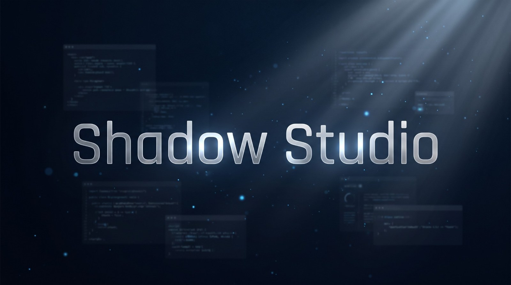

<b>An independent studio making free, practical apps - built to be simple, fast and useful.</b>

## Apps

###  Seekframe

**[Seekframe](https://github.com/ShadowStudioApps/seekframe)** renders three.js / canvas HTML scenes and Blender files
into MP4 videos - up to 4K, 30 fps, with sound, for YouTube (16:9) and Shorts (9:16) - with a quality check on every
video. Its AI makes a narrated, captioned video from one idea, fixes a broken scene and writes the YouTube text, and the
app speaks 11 languages. *(Formerly called Shadow.)*

  

### More to come

More apps of different kinds are on the way and will be listed here. Ideas or bugs? Open an issue on the app's page.
